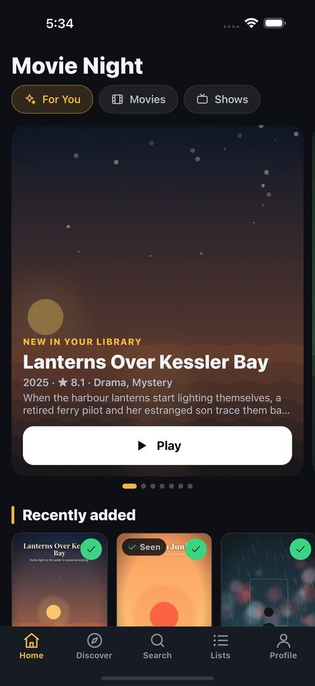
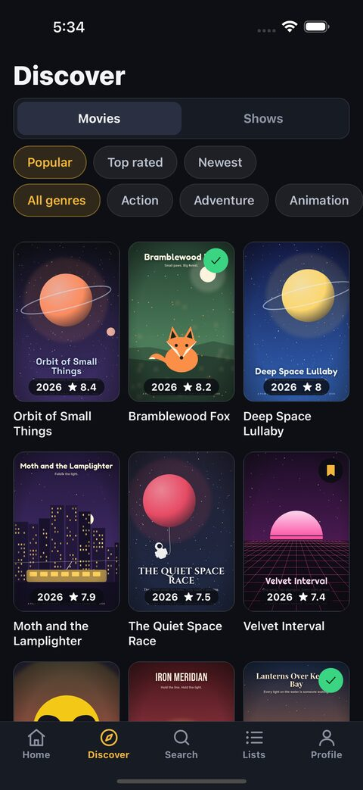
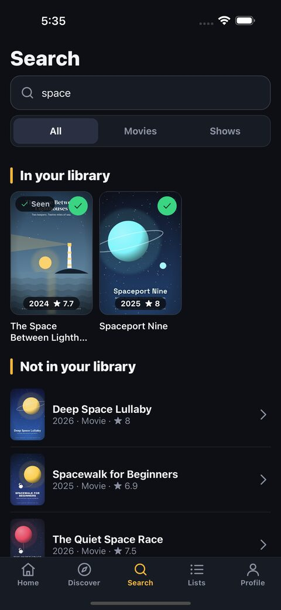
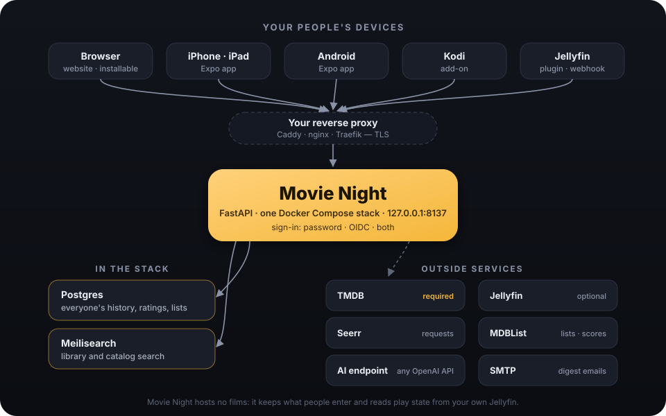

<p align="center"></p>

<h1 align="center">Movie Night</h1>

<p align="center">
A self-hosted movie and TV tracker for you and the people on your Jellyfin server.<br>
Watch history, ratings, lists, requests and "what's next" in one place — on the web, iPhone, Android, Kodi and Jellyfin.
</p>

<p align="center">
<a href="https://ifedan-ed.github.io/movienight/"><b>Documentation</b></a> ·
<a href="https://ifedan-ed.github.io/movienight/self-hosting/">Self-hosting guide</a> ·
<a href="docs/configuration.md">Configuration</a>
</p>

<p align="center">



</p>
<p align="center"><sub>Screenshots use a made-up demo catalog: every title and picture in them is invented.</sub></p>

## What it does

- **Your own watch diary.** History of films and episodes, ratings from 1 to 10 with a short comment, a watchlist, favourites, liked and rated episodes, and lists of your own.
- **Tick off shows season by season**, and see what's up next in everything you follow.
- **Home rows** in the style of a media center: up next, recently added to the server, your watchlist, trending, coming soon, "because you watched" and AI-picked themes (optional).
- **Search that understands a described plot** — "the one where a robot sings to sleeping passengers" — with an optional AI best guess.
- **Jellyfin built in:** library sync, plays from Jellyfin added to your history, ticks sent back, and Play in Jellyfin apps.
- **Play in the player you like:** VLC, Infuse, Outplayer, nPlayer, VidHub, SenPlayer, Swiftfin, Streamyfin or your own link, with subtitles. Afterwards it asks "Finished it?" and records the watch.
- **Requests through Seerr** (optional), followed from waiting to available.
- **Every device:** a website (installable as an app), an iPhone and Android app, a Kodi add-on and a Jellyfin plugin, all talking to your server.
- **Sign in your way:** username and password, any OIDC provider (Authentik, Keycloak, Pocket ID, …), or both.
- **Private by design:** no ads, no analytics, no tracking. Your data stays on your server; everyone can download theirs.

**Movie Night is a watch diary, not a media source.** It does not host, provide, stream, download or index films or television. It keeps what you and your people enter, reads titles and artwork from [TMDB](https://www.themoviedb.org/), and can read play state from a Jellyfin server you control.

## Quick start

You need Docker with Compose, a free [TMDB API key](https://www.themoviedb.org/settings/api) and a domain name with a TLS reverse proxy.

```sh
git clone https://github.com/ifedan-ed/movienight.git
cd movienight
cp .env.example .env && chmod 600 .env
# set SECRET_KEY, POSTGRES_PASSWORD, TMDB_API_KEY, PUBLIC_URL, OWNER_USERNAME, TIMEZONE
# and PASSWORD_SIGNIN=true (or the OIDC_* settings)
docker network create movienight-ai     # once; used by the optional AI container
docker compose up -d --build
docker compose exec web python -m app.cli user add alice --name "Alice"
```

Then point your reverse proxy at `127.0.0.1:8137` and open your address. The full walkthrough — reverse proxy, sign-in, Jellyfin, the phone app, Kodi, backups and upgrades — is in the **[self-hosting guide](https://ifedan-ed.github.io/movienight/self-hosting/)**.

## How it fits together

<p align="center"></p>

| Folder | What's in it |
|---|---|
| `app/` | The server: FastAPI, SQLAlchemy, Alembic migrations in `migrations/` |
| `web/` | The website: plain JavaScript, no build step |
| `mobile/` | The iPhone and Android app (Expo, React Native) — see [mobile/README.md](mobile/README.md) |
| `kodi/` | The Kodi add-on |
| `jellyfin-plugin/` | The Jellyfin plugin (C#), built into the server image and served from `/jellyfin/` |
| `docs/` | [Configuration](docs/configuration.md), [limits and schedules](docs/limits.md), the API description (`openapi.json`) and this site |
| `tests/`, `e2e/` | Server tests (pytest, real Postgres) and browser flows (Playwright) |

## Development

```sh
python3 -m venv .venv && .venv/bin/pip install -r requirements.txt
scripts/test.sh            # starts a throwaway Postgres in Docker and runs the tests
```

The website is plain JavaScript in `web/static/`: edit and reload. The phone app: `cd mobile && npm install && npx expo start`.

After an API change, regenerate the API description the phone app's types come from:

```sh
MOVIENIGHT_NO_ENV_FILE=1 RUN_JOBS=false .venv/bin/python -c "import json; from app.main import app; print(json.dumps(app.openapi(), indent=1, sort_keys=True, ensure_ascii=False))" > docs/openapi.json
cd mobile && npm run types
```

## API

Everything the website and the apps do goes through `/api/v1` (the description is at `/api/v1/openapi.json` and interactive docs at `/api/v1/docs`, both behind sign-in). Writes must carry `X-Requested-With: movienight`.

## License

[AGPL-3.0](LICENSE). Title data and images come from TMDB; this product uses the TMDB API but is not endorsed or certified by TMDB.
