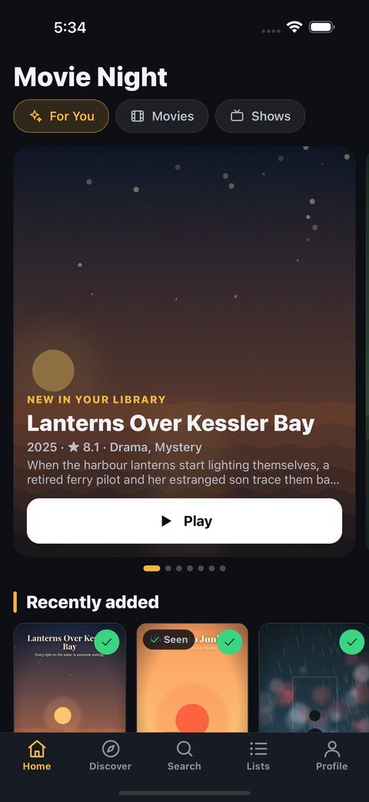
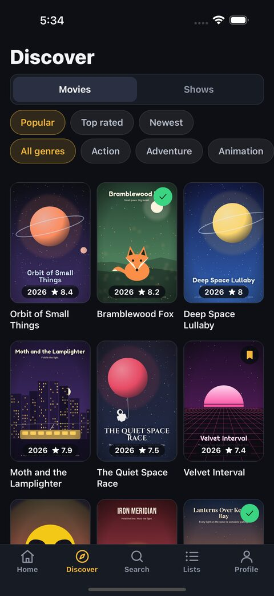
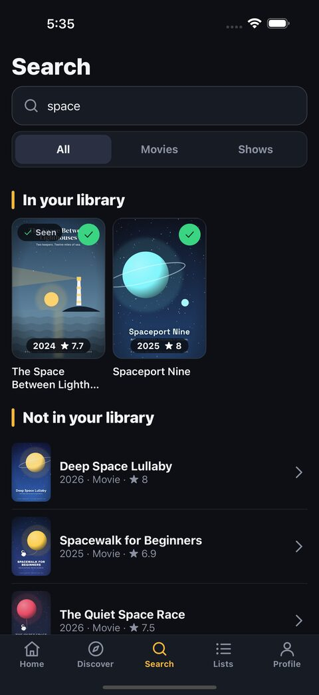
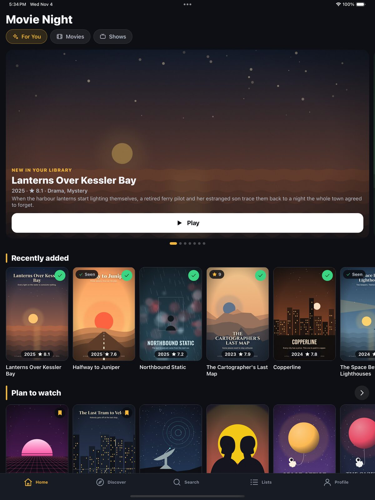

{ width="96" }

# Movie Night

**A self-hosted movie and TV tracker for you and the people on your Jellyfin server.**
Watch history, ratings, lists, requests and "what's next", on the web, iPhone, Android, Kodi and Jellyfin.

[Self-host it](self-hosting.md){ .md-button .md-button--primary } [View on GitHub](https://github.com/ifedan-ed/movienight){ .md-button }

{ width="200" }
{ width="200" }
{ width="200" }

<small>Screenshots use a made-up demo catalog: every title and picture in them is invented.</small>

## What you get

-   **Your own watch diary**

    Films and episodes you've watched, ratings from 1 to 10 with a short comment, a watchlist, favourites and lists of your own.

-   **Shows, season by season**

    Tick off episodes, heart and rate single episodes, and see what's up next in everything you follow.

-   **Home that knows your server**

    Recently added, up next, trending, coming soon, "because you watched" and AI-picked themes (optional).

-   **Search by plot**

    Describe the film you half remember; with an AI endpoint set up, Movie Night names its best guess.

-   **Jellyfin built in**

    Library sync, Jellyfin plays added to your history, ticks sent back, and a plugin for progress from any Jellyfin app.

-   **Play anywhere**

    VLC, Infuse, Outplayer, nPlayer, VidHub, SenPlayer, Swiftfin, Streamyfin or your own player link, with subtitles.

-   **Requests**

    Ask for a film or show through Seerr (optional) and follow it from waiting to available.

-   **Private**

    No ads, no analytics, no tracking. Everything stays on your server, and everyone can download their own data.

## How it works

Movie Night is one Docker Compose stack — the app, Postgres and Meilisearch — behind your own reverse proxy. Titles and artwork come from [TMDB](https://www.themoviedb.org/) (a free API key). Jellyfin, Seerr, MDBList, an OpenAI-compatible AI endpoint and SMTP are all optional.

People sign in with a username and password you give them, with your OIDC provider (Authentik, Keycloak, Pocket ID, …), or either. The phone app, Kodi add-on and Jellyfin plugin use their own device tokens.

!!! note "A watch diary, not a media source"
    Movie Night does not host, provide, stream, download or index films or television. It keeps what you and your people enter, and can read play state from a Jellyfin server you control.

<small>This product uses the TMDB API but is not endorsed or certified by TMDB.</small>
